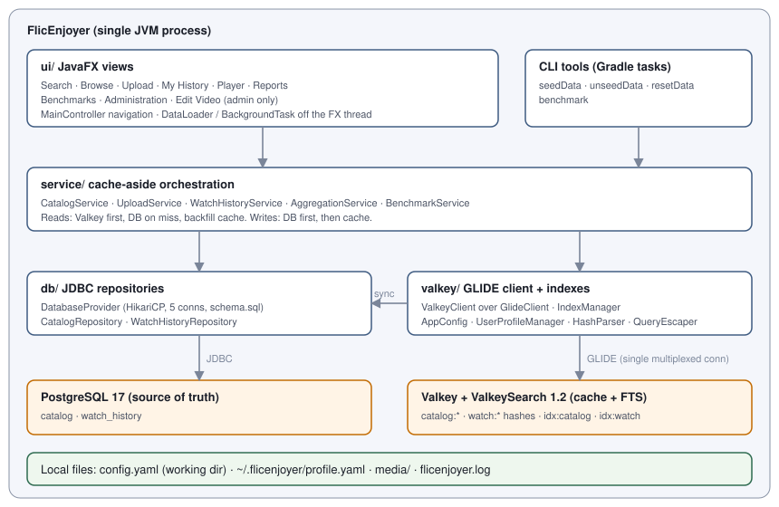

# Technical Architecture

FlicEnjoyer is a single-process JavaFX desktop app. PostgreSQL is the source of truth; Valkey sits beside it as a cache and ValkeySearch full-text index. For what the product does, see [PRODUCT.md](PRODUCT.md). For exact table, key, index, and file layouts, see [SCHEMA.md](SCHEMA.md).

## System overview

The **service layer** is the only place that touches both stores. Views and CLI tools never call `db/` or `valkey/` directly.

- **Cache-aside read**: look up the Valkey hash; on a miss, read PostgreSQL and backfill the hash.
- **Write**: write PostgreSQL first, then update the Valkey hash. ValkeySearch indexes the hash automatically through its key-prefix binding.
- **Startup sync**: `IndexManager` creates `idx:catalog` and `idx:watch` if they are missing, then copies every catalog row into Valkey in pipelined batches so search works immediately. Watch history fills the cache on demand when a profile's history is first read and finds nothing in Valkey.
- **No TTLs**: the app manages cache entries itself, so benchmark runs are deterministic and a flushed Valkey is rebuilt on the next launch.

Search, browse, history listing, and reports query ValkeySearch only. The single exception is the **DB-direct path**: a set of service methods that skip Valkey on purpose, so the benchmark can run the same workload against PostgreSQL alone.

## Third-party components

### Java libraries

| Package | Version | Role |
|---------|---------|------|
| `io.valkey:valkey-glide` (OS classifier) | 2.4.1 | Valkey client: hashes, batches, and FT.CREATE/SEARCH/AGGREGATE/INFO |
| `org.postgresql:postgresql` | 42.7.4 | JDBC driver |
| `com.zaxxer:HikariCP` | 6.2.1 | JDBC connection pool |
| `org.yaml:snakeyaml` | 2.3 | Reads `config.yaml`, reads and writes `profile.yaml` |
| OpenJFX (`controls`, `fxml`, `media`, `swing`) | 26 | Desktop UI, video playback, frame snapshot for thumbnails |
| JUnit Jupiter | 5.11.3 | Unit and integration tests |
| Mockito | 5.14.2 | Mocks for `ValkeyClient` and the JDBC layer |
| Testcontainers (`testcontainers`, `junit-jupiter`, `postgresql`) | 1.21.0 | Live Valkey and PostgreSQL containers for integration tests |

### Build tooling

| Tool | Version | Role |
|------|---------|------|
| Gradle (wrapper) | 9.3.0 | Build, run, CLI tool tasks |
| Java toolchain | 26 | Language level and runtime |
| Spotless + google-java-format | 6.25.0 + 1.36.1 | Formatting gate |
| JaCoCo | 0.8.14 | Coverage gate |
| `com.google.osdetector` | 1.7.3 | Picks the native classifier for valkey-glide |
| `org.openjfx.javafxplugin` | 0.1.0 | Wires JavaFX modules |

### System dependencies

| Component | Role |
|-----------|------|
| `valkey/valkey-bundle:unstable` | Valkey server with ValkeySearch preloaded. `unstable` is the only non-RC bundle tag with ValkeySearch 1.2 or later (it carries 1.3); stable `9.0` carries 1.0. |
| `postgres:17` | Primary datastore. Docker Compose deliberately shrinks its buffers so the tiny demo dataset still misses PostgreSQL's cache, as a large production dataset would. |
| Docker / Docker Compose | Runs both servers locally and backs Testcontainers. |

### Integration boundaries

- **App ↔ Valkey (GLIDE)**: one `GlideClient` connection, multiplexed across all threads, wrapped by the `ValkeyClient` interface so services can be unit-tested with a mock. Every call returns a `CompletableFuture`; services block on `.get()` because they always run off the FX thread. User text reaches FT.SEARCH only after `QueryEscaper` has escaped it.
- **App ↔ PostgreSQL (JDBC)**: a HikariCP pool capped at 5 connections. Under concurrent load this cap is the bottleneck the benchmark exposes. `DatabaseProvider` runs `schema.sql` at startup; tables are created with `IF NOT EXISTS` and there are no migrations.
- **App ↔ local filesystem**: uploaded videos and thumbnails are copied into `~/.flicenjoyer/media/`, and the catalog stores their absolute paths. Deleting a title removes files only when they resolve inside that media directory.
- **App ↔ JavaFX media**: `MediaPlayer` plays local files. Volume and mute changes take effect about 500 ms late; this is a platform limitation.

For field-level layouts of every boundary, see [SCHEMA.md](SCHEMA.md).

## Module responsibilities

All classes live under `com.flicenjoyer`. Allowed dependencies: `ui → service → {db, valkey} → model`. Only `db/` imports JDBC or HikariCP, and only `valkey/` imports valkey-glide.

| Module | Thread | Responsibility |
|--------|--------|----------------|
| `FlicEnjoyerApp` | FX launcher | Entry point: loads logging and config, prompts for the profile, connects both stores, runs the startup sync, builds `MainController`. |
| `SeedData`, `UnseedData`, `ResetData`, `BenchmarkCli` | main | Gradle-task CLIs: add or remove **demo data**, wipe all data and media, run the benchmark headless. |
| `model/` | any | Immutable records (`Movie`, `WatchHistoryEntry`, `AggregationResult`) and the `Genre` enum. |
| `db/DatabaseProvider` | any | Owns the HikariCP pool and applies `schema.sql`. |
| `db/CatalogRepository`, `db/WatchHistoryRepository` | background | JDBC CRUD for the `catalog` and `watch_history` tables. |
| `valkey/ValkeyClientProvider`, `GlideValkeyClient`, `ValkeyClient` | any | Own the single GLIDE connection and the testable interface over it. |
| `valkey/IndexManager` | startup | Creates the FTS indexes and runs the startup catalog sync from PostgreSQL. |
| `valkey/AppConfig`, `AppPaths`, `UserProfileManager` | startup | Load `config.yaml`, define `~/.flicenjoyer` paths, load or create the profile. |
| `valkey/ValkeyKeys`, `HashParser`, `QueryEscaper` | any | Key and index names, conversion between hashes and records, query and tag escaping. |
| `service/CatalogService` | background | Search (prefix and fuzzy merged), browse, cache-aside lookup, metadata, rating, and duration updates, delete, plus DB-direct variants. |
| `service/UploadService` | background | Validates an upload, copies media, inserts into PostgreSQL, then populates the cache hash. |
| `service/WatchHistoryService` | background | Per-profile history, resume points (single and batched), completion, deleting a title's history for all profiles, plus DB-direct variants. |
| `service/AggregationService` | background | FT.AGGREGATE reports: top titles by viewers, catalog summary by genre. |
| `service/BenchmarkService` | benchmark pool | Concurrent throughput harness, DB-vs-Valkey comparison, single-thread latency percentiles, and the paired DB/Valkey tasks with a 7:1 read/write mix. |
| `ui/MainController` | FX | Title bar, hamburger navigation, view switching, per-view show and leave hooks, admin gating. |
| `ui/*View` (`Search`, `Catalog`, `WatchHistory`, `Player`, `Reports`, `Benchmark`, `Admin`) | FX | One screen each. `CatalogView` is **Browse**. |
| `ui/VideoFormView` | FX | Shared form for Upload and Edit Video, including the experimental extract-thumbnail-from-video action. |
| `ui/DataLoader`, `BackgroundTask`, `UiExecutors`, `FxThread` | FX ↔ background | Move work off the FX thread and deliver results back to it. |
| `ui/MovieCard`, `StarRating`, `NotificationBanner`, `IconLoader`, `UiFactory`, `PlaybackState` | FX | Shared widgets: cards, star rating, toast banners, SVG icons loaded from `src/main/resources/icons/`, play/resume labels. |

## Concurrency model

- **FX Application Thread**: owns every node. It never calls Valkey, PostgreSQL, or the disk.
- **`DataLoader`**: a single-thread daemon executor that loads screen data (Browse, History, Administration). Results come back through `Platform.runLater`. A view cancels its pending load when it is left.
- **`BackgroundTask`**: one-off jobs (upload, edit, delete, reports, benchmark) on `UiExecutors.BACKGROUND`, a 2-thread daemon pool, with success, failure, cancel, and finally callbacks on the FX thread.
- **Search**: each keystroke stores the latest query in an `AtomicReference`. An `AtomicBoolean` keeps at most one virtual thread draining that slot, and results superseded by a newer query are dropped before they are rendered.
- **Player**: a 3-second FX `Timeline` triggers the resume-point save. The save itself runs through `CompletableFuture.runAsync` on the common pool, as do rating and completion writes.
- **Benchmark**: `BenchmarkService` creates fixed thread pools of the requested size, one for warmup and one for the timed run, and tracks progress with `AtomicInteger` and `CountDownLatch`.
- **Shared resources**: the GLIDE client is thread-safe and multiplexed. The HikariCP pool blocks callers when all 5 connections are busy. No other mutable state is shared across threads.
